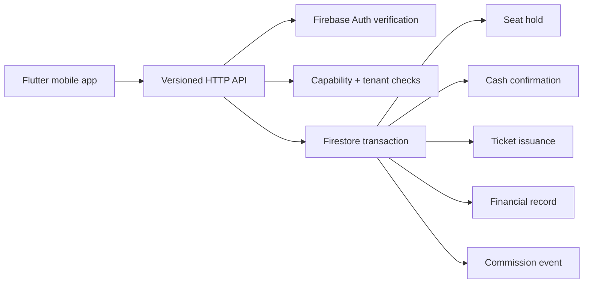

# VIA — Transportation Operations Platform


**VIA** is a portfolio engineering implementation of a multi-tenant transportation and bus-management platform built with **Flutter, Firebase, Firestore, and TypeScript**.

**Author:** Mohammed Yaman Aldous  
**Role:** Mobile App & Full-Stack Developer  
**GitHub:** https://github.com/mohds-rgb

> **Truth boundary:** this repository is an engineering portfolio implementation. It contains source code, security rules, domain tests, demo data, and a runnable local Demo Mode. It does **not** claim production deployment, commercial adoption, live customers, uptime, release distribution, or production Firebase usage.

## What this repository demonstrates

The project focuses on the hardest part of a transport system: **booking seats safely when multiple requests can compete for the same inventory**.



### Implemented vertical slice

`Trip search → seat selection → 10-minute hold → cash-confirmation request → cash confirmation → ticket/finance/commission outcome`

The mobile app starts in a clearly labelled **Demo Mode** backed by an in-memory adapter, so a reviewer can inspect and exercise the flow without production credentials. The production-shaped `RemoteBookingRepository` shows where trusted API calls enter the architecture.

## Concrete demo scenario

The repository uses a deliberately labelled portfolio scenario based on the business information supplied for the project:

| Item | Demo value |
|---|---|
| Operator | Diamond Travel |
| Route | Damascus ↔ Daraa University Area |
| Fleet | 21 buses |
| Capacity | 50 seats per bus |
| Schedule | Flexible, approximately hourly |
| Fare | 50 SYP one-way / 90 SYP round-trip |

These are **demo records**, not proof of a commercial relationship or company endorsement.

## Engineering highlights

| Concern | Approach |
|---|---|
| Seat concurrency | Firestore transaction checks and updates seat state atomically |
| Idempotency | Command-scoped key plus request fingerprint |
| Authorization | Tenant membership + capability checks at the trusted boundary |
| Financial integrity | Fare and commission snapshots; server-owned financial records |
| Booking lifecycle | Explicit state machine with illegal-transition rejection |
| Hold expiry | Ten-minute hold with release-on-expiry behavior |
| Client authority | Security rules deny client control of high-impact fields |
| Mobile architecture | Repository abstraction with separate Demo and Remote adapters |
| Localization | English + Arabic presentation layer |
| Backend contracts | Zod validation around versioned API commands |

## Repository structure

```text
VIA/
├── apps/mobile/        Flutter passenger experience
├── functions/          TypeScript trusted backend commands
├── firebase/           Firestore + Storage rules and indexes
├── data/demo/           Explicit demo dataset and personas
├── test/                Security/concurrency cases and fixtures
├── docs/                Architecture, API, data model, migration and UX docs
├── assets/branding/    VIA app icon and branding source
└── scripts/             Repository + demo-data validation helpers
```

## Quick review path

A reviewer can understand the project quickly by opening:

1. `docs/DEMO_SCENARIO.md` — business context and journey
2. `docs/ARCHITECTURE.md` — system boundaries and responsibilities
3. `functions/src/bookings/hold.ts` — seat transaction
4. `functions/src/bookings/confirm_cash.ts` — ticket + financial transaction
5. `functions/src/infra/idempotency.ts` — replay protection
6. `firebase/firestore.rules` — client authority boundary
7. `docs/ENGINEERING_HIGHLIGHTS.md` — design rationale
8. `docs/VERIFICATION_STATUS.md` — what was actually checked locally

## Run the mobile demo

No production Firebase project is required for the visible demo flow:

```powershell
cd apps/mobile
flutter pub get
flutter run
```

The app is intentionally wired to the in-memory Demo Mode at startup. This demonstrates the user journey without pretending that demo data is a live backend.

## Run the backend checks

```powershell
cd functions
npm install
npm run lint
npm run typecheck
npm test
```

Firebase Emulator Suite configuration and seed instructions are documented in `docs/EMULATOR_WORKFLOW.md`. Emulator integration is optional for this portfolio package and is not represented as completed unless actually run.

## Verification snapshot

The owner-machine verification captured on **2026-10-04** showed:

- repository and demo-data validation passed;
- `flutter pub get` passed;
- `flutter analyze` reported no issues;
- 11 Flutter tests passed;
- backend install, ESLint, TypeScript typecheck, and 10 backend unit/domain tests passed.

Four Emulator integration cases were present but skipped because the Emulator Suite was not running during that command. APK/release verification is intentionally **out of scope for this portfolio package**.

## Scope boundary

This repository intentionally does not claim to include a production deployment. Deferred work includes real Google Sign-In configuration, live Firebase deployment, production secrets, release signing/distribution, production App Check/FCM configuration, and the wider operator/driver/finance modules described in the broader VIA specification.

That boundary is part of the project design: **implemented source is presented as implemented source, and future work is presented as future work.**

## About the author

**Mohammed Yaman Aldous**  
Mobile App & Full-Stack Developer  
GitHub: https://github.com/mohds-rgb

## License

MIT — see `LICENSE`.
